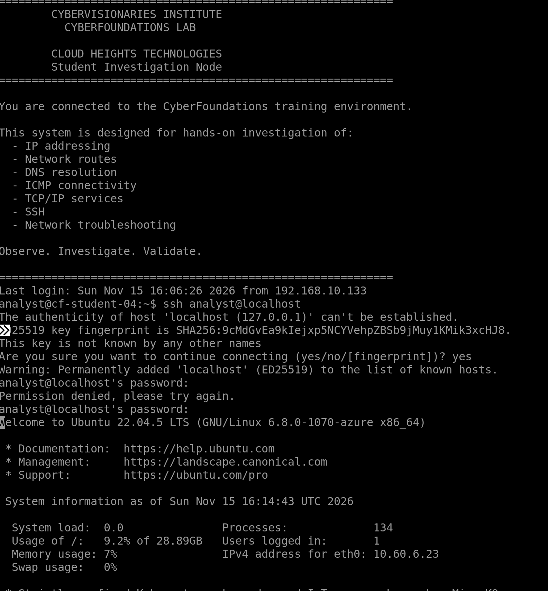

# Week 6 Lab 02 — Knocking on Door 22

**Student Name:** Aisha Shadrawy

**Date Completed:** November 03, 2026

**Module:** 2 — Networking & Cloud Foundations | **Week:** 6  
**Submission Path:** `week-06/labs/lab-02-knocking-on-door-22.md`

---

> ### 🔒 Cloud Heights Security Rule
> Your Bastion link and Cloud Heights password are **private access credentials**. Never paste either into a worksheet, screenshot, GitHub repository, Circle post, or chat message. When taking screenshots, crop out the browser address bar and all login information.

---

## Overview

Week 5 told you SSH is how administrators reach a machine over the network, and that it knocks on **port 22**. This week you knock yourself. You are already inside Cloud Heights through Bastion — now you will open a second, nested SSH session from your machine *to itself* and watch every step of what SSH does before it lets you in.

Starts **guided**, finishes **independent**. Expect 30–40 minutes.

**This lab uses password authentication only.** SSH keys are Week 8. Do not go looking for them yet.

---

## Lab Environment / Pre-Lab Check

| Component | Details |
|---|---|
| Environment | Cloud Heights — live Ubuntu 22.04 VM, reached through Azure Bastion |
| Username | `analyst` |
| Password | Provided separately. Never typed into this worksheet. |
| Commands used | `ssh`, `whoami`, `hostname`, `pwd`, `exit` |
| Prerequisite | Week 6 Lab 01 completed |

**Before you start:** open **My Lab Environment**, start your VM if needed, wait for **Running**, then open Cloud Heights.

---

## Part A — Two Ways Into the Same Room

### Step 1 — Name the Path You Already Used

You reached Cloud Heights through a browser session. Something else handled the network hop for you.

Describe, in your own words, what the Bastion/browser path did on your behalf:

```
Bastion allowed me to connect to my virtual machine safely through my browser. It handled the connection for me, so I didn't have to connect directly to the machine. 
```

### Step 2 — Predict the Manual Path

You are about to type an SSH command by hand. Before you run it, write what you expect to happen and what you expect to be asked for:

```
I expect the SSH command to connect me to my virtual machine. It may ask me to confirm the connection and enter a password or use an SSH key to prove my identity. Once connected, I should be able to type commands into the machine. 
```

---

## Part B — Knocking

### Step 1 — Run the SSH Command

In your Cloud Heights terminal, run:
```
ssh analyst@localhost
```

After you press Enter, SSH may show one of two valid responses.

- If this SSH client has not recorded `localhost` before, you may receive a **first-connection host fingerprint prompt**.
- If `localhost` is already recorded as a known host, SSH may skip that prompt and take you **directly to password authentication**.

Both are valid. Continue with the instructions that match what you see.

### Step 2 — Observe the SSH Connection

The first time SSH connects to an unfamiliar host, it may display the host's **fingerprint** and ask whether you want to continue connecting.

If the host is already recorded in your SSH `known_hosts` file, SSH may skip this confirmation and proceed directly to authentication.

**Do not reset or delete SSH trust information just to make the first-connection prompt appear.**

**If you see the fingerprint prompt:** stop and read it, record it below, answer the question that follows, and then type `yes` when you are ready to continue. A fingerprint is **not** a credential — it is a public identifier of the machine, so it is safe to record.

**If you do not see the fingerprint prompt:** this is okay. It means SSH already recognises `localhost` as a known host in this environment. Write `Host already known — fingerprint prompt not displayed.` below and continue to Step 3. You lose no credit for this.

Record what SSH showed you — paste the first-connection prompt, or write `Host already known — fingerprint prompt not displayed.`:

```
The authenticity of host 'localhost (127.0.0.1)' can't be established.
ED25519 key fingerprint is SHA256:9cMdGvEa9kIejxp5NCYVehpZBSb9jMuy1KMik3xcHJ8who

```

Why does SSH verify a host's identity when connecting to an unfamiliar system? If you received the first-connection prompt, also explain why it was reasonable to continue in this controlled Cloud Heights lab environment:

```
SSH checks the computer's identity to make sure I'm connecting to the correct machine and not a fake one. It was reasonable to continue because I was using a trusted, controlled lab environment where the machine was already set up for me. 
```

### Step 3 — Enter Your Password

> ### ⚠️ PASSWORD INPUT WILL BE INVISIBLE
> When SSH asks for the `analyst` password, type or paste the password and press Enter.
>
> Linux does not display password input.
>
> You will **NOT** see:
> - letters or numbers
> - dots
> - asterisks
> - the cursor moving as characters are entered
>
> This is normal.
>
> The terminal may look like nothing is happening even though it is accepting the password.
>
> Enter the password once, press Enter once, and wait for SSH to respond.
>
> If clipboard paste does not work in your browser/Bastion terminal, type the password manually.

If you saw the fingerprint prompt, type `yes` first. Then enter your password at the password prompt.

**Troubleshooting.** If you get `Permission denied`, do not repeatedly retry credentials — capture the error and contact your instructor or post in the Lab Troubleshooting space. If you enter the password, press Enter, wait several seconds, and get neither a new prompt nor an error, capture the entire terminal state for troubleshooting. Do not restart the whole lab on your own.

What did the screen show while you typed:

```
nothing, just the cursor
```

### Step 4 — Prove You Are in the Nested Session

Inside the new session run each of these and record the output:
```
whoami
```

```
analyst
```

```
hostname
```

```
cf-student-04
```

```
pwd
```

```
/home/analyst
```

### Step 5 — Notice the Prompt

Compare the prompt now to the prompt before you ran `ssh`. Describe anything that changed and anything that looks identical, and explain why it looks that way given where you connected to:

```
My prompt looked almost the same because I connected to the same machine using the same username. I was not inside a second SSh session, but the computer and account hadn't changed
```

### Step 6 — Capture Your Evidence

Screenshot your terminal showing the SSH connection activity. **Either** valid state is accepted:

- **State A** — a screenshot showing the SSH **first-connection / fingerprint prompt** (and the successful session), **or**
- **State B** — a screenshot showing the SSH **authentication / successful login** state when `localhost` was already a known host.

Your screenshot must show that you performed the SSH connection. You are not penalised if the fingerprint prompt was never generated.

**Required filename:** `ssh-first-connection.png` (filename kept for submission compatibility — its contents may show either state)

**Crop rules.** No Bastion URL, no address bar, no password field, no login screen. The fingerprint text, if present, is fine.



### Step 7 — Leave

Run:
```
exit
```
What did the prompt look like after exiting, and how do you know you are back in the original session:

```
logout
Connection to localhost closed.
My prompt returned to the original session. This showed that I had the nested SSH session without disconnecting from  Cloud heights. 
```

---

## Part C — The Deliberate Failure (Independent)

### Step 1 — Knock With the Wrong Name

Run an SSH command to `localhost` using a username that does not exist on this machine — for example `ssh notauser@localhost`. Enter anything at the password prompt.

Command you ran:

```
ssh notauser@localhost
```

Output:

```
notauser@localhost's password
Permission denied, please try again.exit
```

### Step 2 — Read the Failure Correctly

`Permission denied` is a **failure of authentication**, not a failure of the network.

Explain what the network and SSH already had to do successfully in order for you to be told "permission denied" at all:

```
The network successfully connected me to the machine, and SSH was working because it asked for a password. The connection reached the authentication stage, but the username was incorrect. That's why I received "Permission denied" instead of a network error. 
```

---

## Analysis Questions

**Analysis Question 1.** Distinguish *reach* from *authentication*. Which one had already succeeded when you saw a password prompt, and how do you know? *(Minimum 3 sentences.)*

```
Reach means my computer can communicate with another machine over the network. Authentication means proving I have permission to log in. When SSH asked for my password, I knew the connection had already reached the machine successfully.
```

**Analysis Question 2.** SSH records a host's identity so it can warn you if that identity ever changes. Describe a situation where accepting a host fingerprint without thinking — or ignoring a changed-host warning — would be a real problem. *(Minimum 3 sentences.)*

```
If I connect to a machine without checking its fingerprints, I could accidentally connect to a fake server pretending to be the real one. Someone could use that fake server to steal my login information. That's why I shouldn't ignore fingerprint warnings, especially if the identity suddenly changes. 
```

**Analysis Question 3.** What changed and what stayed the same when you moved from the outer session into the nested SSH session, and why? *(Minimum 2 sentences.)*

```
I opened the second SSH session inside my original session. My username, hostname, and name directly stayed the same because I connected back to the same machine as the same user. The connection changed, but the computer I was using didn't. 
```

**Analysis Question 4.** A colleague says "SSH is broken, I got permission denied." Using only what you learned in this lab, what would you tell them is already working, and what would you check next? *(Minimum 3 sentences.)*

```
I would explain that SSH isn't necessarily broken because the connection successfully reached the machine and asked for a password. The problem is most likely related to authentication. I would check that they are using the correct username and credentials before assuming something is wrong with the network. 
```

---

## Submission Checklist

- [x] Bastion path vs. manual SSH path described (Part A)

- [x] `ssh analyst@localhost` run and the SSH response recorded — fingerprint prompt **or** "host already known" (Part B, Steps 1–2)

- [x] Password entered; non-echoing input observed and described (Part B, Step 3)

- [x] `whoami`, `hostname`, `pwd` run inside the nested session (Part B, Step 4)

- [x] Prompt change described (Part B, Step 5)

- [x] `ssh-first-connection.png` captured (fingerprint prompt **or** authentication/login state), cropped, uploaded to `assets/screenshots/week-06/` (Part B, Step 6)

- [x] Session exited cleanly (Part B, Step 7)

- [x] Bad-username test run and `Permission denied` output recorded (Part C)

- [x] All four Analysis Questions answered (minimum sentence counts met)

- [x] This file is committed to your portfolio repo at `week-06/labs/lab-02-knocking-on-door-22.md`

---

## GitHub Commit Subsection

1. Open **Week 6 → Lab 02: Knocking on Door 22** in the Lab Portal.
2. Fill in the worksheet fields and upload `ssh-first-connection.png` to `assets/screenshots/week-06/`.
3. Click **Submit to GitHub** — the Portal commits to `week-06/labs/lab-02-knocking-on-door-22.md`.

---

*CyberVisionaries Institute · Cyber Foundations · Tier I*
