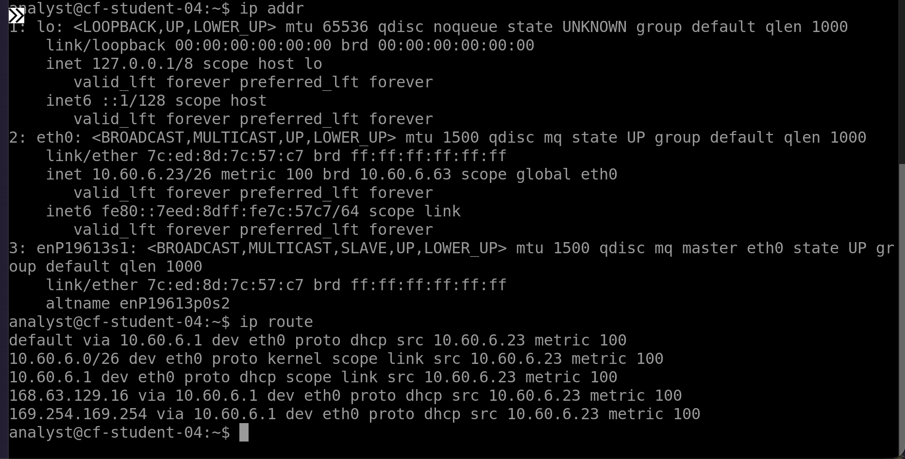
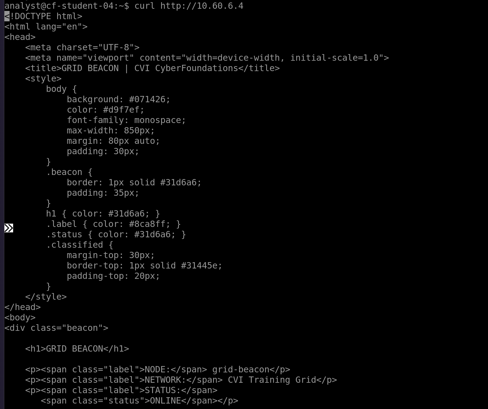

# Week 6 Lab 03 — The Grid, For Real

**Student Name:** Aisha Shadrawy

**Date Completed:** November 03, 2026

**Module:** 2 — Networking & Cloud Foundations | **Week:** 6  
**Submission Path:** `week-06/labs/lab-03-the-grid-for-real.md`

---

> ### 🔒 Cloud Heights Security Rule
> Your Bastion link and Cloud Heights password are **private access credentials**. Never paste either into a worksheet, screenshot, GitHub repository, Circle post, or chat message. When taking screenshots, crop out the browser address bar and all login information.

---

## Overview

In Week 5 you ran `ip addr`, `ip route`, `ping`, and `traceroute` in a simulator that always behaved. Today you run the same toolkit against real cloud infrastructure that does **not** always behave the way the textbook implies — and you learn to tell "broken" apart from "normal."

This is an **independent** lab. It tells you what to accomplish; you choose the commands. Expect about 40 minutes.

---

## Lab Environment / Pre-Lab Check

| Component | Details |
|---|---|
| Environment | Cloud Heights — live Ubuntu 22.04 VM, reached through Azure Bastion |
| Commands used | `ip addr`, `ip route`, `ping`, `traceroute`, `curl` |
| Known-good target | **Grid Beacon — `10.60.6.4`** |
| Prerequisite | Week 6 Labs 01–02 |

---

## Part A — Where You Actually Are

### Step 1 — Read Your Own Address

Run the command that lists your interfaces and addresses.

Command and output:

```
ip addr
```

Your private IPv4 address and prefix length:

```
10.30.6.23/26
```

### Step 2 — Read Your Route

Run the command that shows the routing table.

Command and output:

```
ip route
```

Your default gateway:

```
10.60.6.1
```

### Step 3 — Compare to Week 5

Compare this live Ubuntu output to what the CLI Simulator produced in Week 5. What looks the same, what looks different, and what surprised you:

```
Both the live Ubuntu machine and the Week 5 simulator use similar Linux commands and show similar results. The live Ubuntu machine shows more details and feels more realistic. What surprised me was the inability to move freely after a command was entered. 
```

---

## Part B — The Gateway That Does Not Answer

### Step 1 — Ping the Gateway

Ping the default gateway address you recorded. Let it run a few seconds, then stop it.

Command and output:

```
PING 10.60.6.1(10.60.6.1) 56(84) bytes of data

```

### Step 2 — Interpret It Correctly

You almost certainly got **no replies**. In Azure, the platform gateway commonly does not answer ICMP. This is **expected platform behaviour** and by itself proves nothing about whether your machine or network is broken.

Explain why "the gateway did not answer ping" is weak evidence:

```
The gateway not answering my ping doesn't mean the network is broken. Azure gateways often don't respond to pings. I would need to run other tests to see if the network is actually working. 
```

---

## Part C — The Known-Good Target

The **Grid Beacon** at `10.60.6.4` is a machine that is known to be up and known to answer. When your first probe fails, you test against something known-good before you conclude anything.

### Step 1 — Ping the Beacon

```
ping 10.60.6.4
```
Output:

```
nalyst@cf-student-04:~$ ping 10.60.6.4
PING 10.60.6.4 (10.60.6.4) 56(84) bytes of data.
64 bytes from 10.60.6.4: icmp_seq=1 ttl=64 time=1.08 ms
64 bytes from 10.60.6.4: icmp_seq=2 ttl=64 time=1.11 ms
64 bytes from 10.60.6.4: icmp_seq=3 ttl=64 time=3.80 ms
64 bytes from 10.60.6.4: icmp_seq=4 ttl=64 time=1.07 ms
64 bytes from 10.60.6.4: icmp_seq=5 ttl=64 time=1.17 ms
64 bytes from 10.60.6.4: icmp_seq=6 ttl=64 time=4.96 ms
64 bytes from 10.60.6.4: icmp_seq=7 ttl=64 time=1.12 ms
64 bytes from 10.60.6.4: icmp_seq=8 ttl=64 time=1.16 ms
64 bytes from 10.60.6.4: icmp_seq=9 ttl=64 time=2.04 ms
64 bytes from 10.60.6.4: icmp_seq=10 ttl=64 time=1.08 ms
64 bytes from 10.60.6.4: icmp_seq=11 ttl=64 time=1.10 ms
64 bytes from 10.60.6.4: icmp_seq=12 ttl=64 time=1.15 ms
64 bytes from 10.60.6.4: icmp_seq=13 ttl=64 time=1.21 ms
64 bytes from 10.60.6.4: icmp_seq=14 ttl=64 time=1.02 ms
64 bytes from 10.60.6.4: icmp_seq=15 ttl=64 time=1.24 ms
64 bytes from 10.60.6.4: icmp_seq=16 ttl=64 time=1.09 ms
64 bytes from 10.60.6.4: icmp_seq=17 ttl=64 time=1.39 ms
64 bytes from 10.60.6.4: icmp_seq=18 ttl=64 time=1.16 ms
64 bytes from 10.60.6.4: icmp_seq=19 ttl=64 time=1.22 ms
64 bytes from 10.60.6.4: icmp_seq=20 ttl=64 time=1.14 ms
64 bytes from 10.60.6.4: icmp_seq=21 ttl=64 time=1.08 ms
64 bytes from 10.60.6.4: icmp_seq=22 ttl=64 time=1.15 ms
```

### Step 2 — Trace the Path

```
traceroute 10.60.6.4
```
Output:

```
traceroute to 10.60.6.4 (10.60.6.4), 30 hops max, 60 byte packets
  1 grid-beacon.internal.cloudapp.net (10.60.6.4) 1.648 ms 1.876 ms 1.863 ms

```

### Step 3 — Ask the Application

```
curl http://10.60.6.4
```
Output:

```
!DOCTYPE html>
<html lang="en">
<head>
    <meta charset="UTF-8">
    <meta name="viewport" content="width=device-width, initial-scale=1.0">
    <title>GRID BEACON | CVI CyberFoundations</title>
    <style>
        body {
            background: #071426;
            color: #d9f7ef;
            font-family: monospace;
            max-width: 850px;
            margin: 80px auto;
            padding: 30px;
        }
        .beacon {
            border: 1px solid #31d6a6;
            padding: 35px;
        }
        h1 { color: #31d6a6; }
        .label { color: #8ca8ff; }
        .status { color: #31d6a6; }
        .classified {
            margin-top: 30px;
            border-top: 1px solid #31445e;
            padding-top: 20px;
        }
    </style>
</head>
<body>
<div class="beacon">

    <h1>GRID BEACON</h1>

    <p><span class="label">NODE:</span> grid-beacon</p>
    <p><span class="label">NETWORK:</span> CVI Training Grid</p>
    <p><span class="label">STATUS:</span>
       <span class="status">ONLINE</span></p>

    <p>
        Network beacon established.<br>
        If you reached this node, your route is operational.
    </p>

    <div class="classified">
        <p>INVESTIGATION CHECKPOINT</p>

        <p>
            Observe the path that brought you here.
            The destination is only part of the story.
        </p>

        <p>TRACE ID: CF-NET-0604</p>
    </div>

</div>
</body>
</html>
```

> ### ⚠️ Grid Beacon not responding?
> The Grid Beacon is shared course infrastructure and should normally be available. First, confirm your Cloud Heights VM shows **Running** and that you completed the preceding network checks. Then retry the command once after a minute or two.
>
> If the Grid Beacon still does not respond, **stop this part of the lab and contact your instructor.** Record that the shared service was unavailable; do not treat the result as evidence that your VM or your work is incorrect.
>
> Do not change networking, NSGs, firewall rules, routes, DNS, or any Azure settings to try to reach the beacon.
>
> *Instructor note: a confirmed Grid Beacon outage is an environment issue, not a student error. Affected students may complete this portion of Lab 03 after the service is restored, with no penalty.*

### Step 4 — Record the Application Evidence

The beacon returns a banner and a trace ID. Record exactly what you received:

```
title>GRID BEACON | CVI CyberFoundations</title>
<p>TRACE ID: CF-NET-0604</p>
```

Explain the difference between what the `ping` proved and what the `curl` proved:

```
the ping tested whether the server responded over the network. The curl proved that I could connect to the Grid Beacon and receive information from its website, including the trace ID.
```

### Step 5 — Capture Your Evidence

Two screenshots, both cropped to the terminal only:

**Required filename:** `vm-toolkit-live.png` — your `ip addr` and `ip route` output



**Required filename:** `beacon-reply.png` — your beacon ping/traceroute/curl evidence



---

## Part D — Rewrite the Ladder Rule

Week 5 taught the Ladder Rule: test the near thing before the far thing. Real infrastructure adds a wrinkle — a silent rung is not automatically a broken rung.

Rewrite the Ladder Rule in your own words so that it survives real cloud infrastructure. Your version must include both **route/path evidence** and **a known-good target**:

```
Start by testing what's closest to me, then work my way outward. Check the route or path to see where traffic is going, and test a known target to confirm the network works. Just because something doesn't respond doesn't mean it's broken.
```

---

## Analysis Questions

**Analysis Question 1.** Your ping to the gateway failed and your ping to the beacon succeeded. What does that pair of results, taken together, prove about your machine's networking? *(Minimum 3 sentences.)*

```
The gateway didn't respond because Azure gateways often ignore pings. The beacon responded, which shows my machine can communicate with another system. This tells me my network connection is working even though the gateway didn't answer. 
```

**Analysis Question 2.** Why is `traceroute` useful even when `ping` already answered? What extra thing does it show you? *(Minimum 2 sentences.)*

```
Traceroute shows the path my traffic takes to reach another system, Unlike ping, it can show the different stops along the way and help identify where problems might occur.
```

**Analysis Question 3.** A service is unreachable and ping to it succeeds. Where would you look next, and why is "the network is fine" an incomplete answer? *(Minimum 3 sentences.)*

```
I would check the service, its ports, and firewall rules. Ping only shows that the machine responds, not that the application is working. The network path might work while the service itself is having problems. 
```

**Analysis Question 4.** Something already controls what is allowed to reach your machine in Cloud Heights. If you could decide those rules, what would you want to allow, what would you want to block, and who in an organization should get to make that decision? *(Minimum 3 sentences.)*

```
I would allow only the connections needed to do my work, such as approved SSH access. I would block unknown or unnecessary connections to protect the machine. The IT or cybersecurity team should decide these rules because they're responsible for keeping the organization's systems secure. 
```

---

## Submission Checklist

- [x] `ip addr` output recorded and own private IP/prefix identified (Part A)

- [x] `ip route` output recorded and default gateway identified (Part A)

- [x] Live output compared to the Week 5 simulator (Part A, Step 3)

- [x] Gateway pinged and the silent result interpreted correctly (Part B)

- [x] Beacon `ping`, `traceroute`, and `curl` all run and recorded (Part C)

- [x] Beacon banner and TRACE ID recorded (Part C, Step 4)

- [x] `vm-toolkit-live.png` and `beacon-reply.png` captured, cropped, uploaded to `assets/screenshots/week-06/` (Part C, Step 5)

- [x] Ladder Rule rewritten with route evidence + known-good target (Part D)

- [x] All four Analysis Questions answered (minimum sentence counts met)

- [x] This file is committed to your portfolio repo at `week-06/labs/lab-03-the-grid-for-real.md`

---

## GitHub Commit Subsection

1. Open **Week 6 → Lab 03: The Grid, For Real** in the Lab Portal.
2. Fill in the worksheet fields and upload both screenshots to `assets/screenshots/week-06/`.
3. Click **Submit to GitHub** — the Portal commits to `week-06/labs/lab-03-the-grid-for-real.md`.

---

*CyberVisionaries Institute · Cyber Foundations · Tier I*
